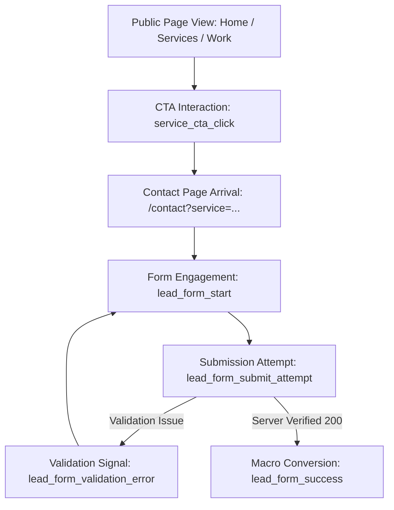

# KreaitX — Analytics, Conversion Tracking & CRO Measurement Plan

This document establishes the official measurement taxonomy, conversion definitions, data minimization policies, and conversion rate optimization (CRO) architecture for the KreaitX website.

---

## 1. Executive Summary & Core Objective

The primary business objective of the KreaitX website is to educate prospective clients on our connected creative technology model and generate **qualified, verified project inquiries**.

### Fundamental Measurement Principles
1. **Meaningful Outcomes Over Noise**: We track real conversion milestones—not vanity button clicks or passive page scrolls.
2. **Strict Data Minimization**: Personal identifiable information (PII)—including names, email addresses, phone numbers, and project brief text—is strictly excluded from analytics events.
3. **Graceful Fault Tolerance**: Analytics failures, ad-blockers, or network latency must never disrupt the visitor experience or block form submissions.
4. **Verified Attribution**: The macro-conversion event (`lead_form_success`) fires strictly upon server-side HTTP 200 confirmation, ensuring zero phantom conversions.

---

## 2. Event Taxonomy & Data Contracts

| Event Name | Event Category | Business Intent | Trigger Condition | Parameters Collected |
| :--- | :--- | :--- | :--- | :--- |
| **`lead_form_start`** | Form Telemetry | Measures user intent to inquire | User focuses an input field or toggles a service pill on `/contact` (once per session) | `form_id: "studio_inquiry"` `trigger: "input_focus" \| "service_pill_click"` |
| **`lead_form_validation_error`** | Form Friction | Identifies UX barriers preventing completion | User clicks submit, but one or more required fields fail validation | `form_id: "studio_inquiry"` `error_field: "fullName" \| "email" \| "projectDetails"` |
| **`lead_form_submit_attempt`** | Funnel Step | Measures submission dispatch and network latency | User submits validated form payload to `/api/contact` | `form_id: "studio_inquiry"` `service_count: number` `has_budget: boolean` `has_timeline: boolean` |
| **`lead_form_success`** | **Macro Conversion** | Verified client lead received by studio leadership | `/api/contact` returns HTTP 200 with `{ success: true }` | `form_id: "studio_inquiry"` `service_count: number` `budget_tier: string` `timeline: string` |
| **`lead_form_server_error`** | Reliability Signal | Alerts engineering to network or delivery failures | `/api/contact` returns 4xx/5xx or throws a network exception | `form_id: "studio_inquiry"` `error_code: string` |
| **`service_cta_click`** | Mid-Funnel Intent | Measures conversion momentum from service descriptions toward contact | User clicks "Start a Project", "Inquire Directly", or primary CTAs | `cta_location: string` `cta_text: string` |
| **`case_study_click`** | Mid-Funnel Proof | Measures engagement with portfolio artifacts | User clicks a case study card from `/` or `/work` | `case_study_slug: string` `source: string` |
| **`direct_contact_click`** | Alternative Lead | Measures off-form inquiries via direct email link | User clicks `mailto:contact@kreaitx.com` | `channel: "email"` `location: string` |

---

## 3. Privacy Safeguards & Anti-PII Enforcement

In compliance with global data privacy frameworks (GDPR, CCPA), the analytics architecture enforces an programmatic PII firewall in `lib/analytics.ts`.

### Automatically Sanitized Fields
The following keys are stripped from event payloads before dispatch:
- `name` / `fullName`
- `email`
- `phone`
- `message` / `projectDetails`
- `company` / `companyName`

Only categorical parameters (e.g. `budget_tier: "$15,000 – $35,000"`, `service_count: 2`, `timeline: "1 – 3 Months"`) are transmitted to tracking providers.

---

## 4. Conversion Deduplication Architecture

A common flaw in single-page applications is double-counting conversions due to React rerenders or double-clicking.
KreaitX implements in-memory reference guards in `components/sections/ContactClient.tsx`:
- `hasStartedRef = useRef(false)`: Ensures `lead_form_start` fires at most once per page session.
- `hasConvertedRef = useRef(false)`: Ensures `lead_form_success` fires exactly once per verified submission. If the user stays on the page or triggers a state update, repeated conversion events are blocked.

---

## 5. CRO Funnel Diagnostics & Action Thresholds

### Key Diagnostic Metrics
1. **CTA-to-Form Arrival Rate**: `(Visits to /contact) / (service_cta_click count)`
   - *Target*: > 85%. Drop-off indicates broken links or sluggish route transitions.
2. **Form Start-to-Submit Rate**: `(lead_form_submit_attempt count) / (lead_form_start count)`
   - *Target*: > 50%. Drop-off indicates form length or cognitive overload.
3. **Form Error Rate**: `(lead_form_validation_error count) / (lead_form_submit_attempt count)`
   - *Target*: < 15%. Spikes indicate confusing field requirements or overly restrictive formatting.
4. **Form Completion Rate**: `(lead_form_success count) / (lead_form_start count)`
   - *Target*: > 35%.

---

## 6. Verified Conversion Rate Optimizations (Implemented)

1. **Inbound Context Badge**:
   - Visitors arriving from `/solutions/branding` or `/work/aurora-healthcare` with query parameters (`?service=...` or `?project=...`) now see an elegant context badge at the top of the form:
     `✨ Inquiring for: Branding • Form pre-scoped`
   - *Benefit*: Reassures the user that their intent was preserved and simplifies the interaction.
2. **Reassurance Signals at Submit**:
   - The submit button is reinforced with explicit trust copy:
     `Direct senior practitioner review • Response within 24h • Strict NDA confidentiality • No spam`
   - *Benefit*: Reduces enterprise anxiety and encourages high-ticket project leaders to submit.
3. **Inline Validation Telemetry**:
   - Field errors are isolated and reported categorially to analytics, allowing engineering to identify if specific inputs (e.g., project details length) cause friction.

---

## 7. Google Analytics 4 Dashboard Configuration

When activating `NEXT_PUBLIC_GA_ID=G-XXXXXXXXXX` in Vercel:

### Recommended Custom Dimensions (GA4 Admin > Custom Definitions)
1. `form_id` (Event Scope)
2. `service_count` (Event Scope)
3. `budget_tier` (Event Scope)
4. `timeline` (Event Scope)
5. `error_field` (Event Scope)
6. `cta_location` (Event Scope)

### Standard Conversion Marking
1. Navigate to **GA4 > Admin > Events**.
2. Find `lead_form_success` and toggle **Mark as conversion**.
3. Also verify that standard `generate_lead` is marked as a conversion.

---

## 8. Provider Independence
If the studio transitions to a cookieless analytics solution (such as Plausible or Vercel Analytics), updates are made exclusively in `lib/analytics.ts`. All UI components and instrumentation remain unchanged.
